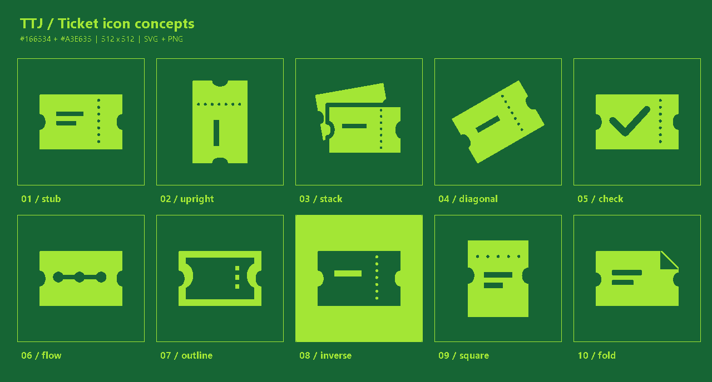

# Ticket app icon：10案

緑`#166534`と黄緑`#A3E635`だけを使った、Ticketモチーフのapp iconです。各案は1:1・512×512 pxのPNGと、拡大縮小できるSVGを用意しています。

| 案 | 特徴 | PNG | SVG |
|---|---|---|---|
| 01 Stub | 横長Ticketとstubのperforation | [PNG](assets/app-icons/01-stub.png) | [SVG](assets/app-icons/01-stub.svg) |
| 02 Upright | 縦向きのTicket | [PNG](assets/app-icons/02-upright.png) | [SVG](assets/app-icons/02-upright.svg) |
| 03 Stack | 2枚を重ねたTicket | [PNG](assets/app-icons/03-stack.png) | [SVG](assets/app-icons/03-stack.svg) |
| 04 Diagonal | 斜めに配置したTicket | [PNG](assets/app-icons/04-diagonal.png) | [SVG](assets/app-icons/04-diagonal.svg) |
| 05 Check | Ticketとcheck | [PNG](assets/app-icons/05-check.png) | [SVG](assets/app-icons/05-check.svg) |
| 06 Flow | Ticketと3つの連結node | [PNG](assets/app-icons/06-flow.png) | [SVG](assets/app-icons/06-flow.svg) |
| 07 Outline | Ticketの輪郭 | [PNG](assets/app-icons/07-outline.png) | [SVG](assets/app-icons/07-outline.svg) |
| 08 Inverse | 黄緑を背景にしたTicket | [PNG](assets/app-icons/08-inverse.png) | [SVG](assets/app-icons/08-inverse.svg) |
| 09 Square | 正方形に近いTicket | [PNG](assets/app-icons/09-square.png) | [SVG](assets/app-icons/09-square.svg) |
| 10 Fold | 角を折ったTicket | [PNG](assets/app-icons/10-fold.png) | [SVG](assets/app-icons/10-fold.svg) |

文字・gradient・shadowを入れず、色・形・余白で識別できる構成です。拡大縮小や加工にはSVG、画像として使う場合はPNGを選べます。
