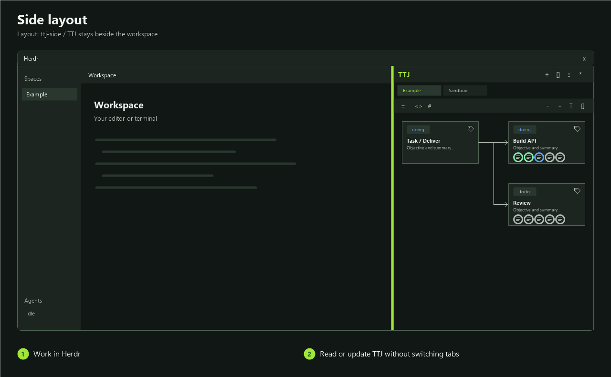
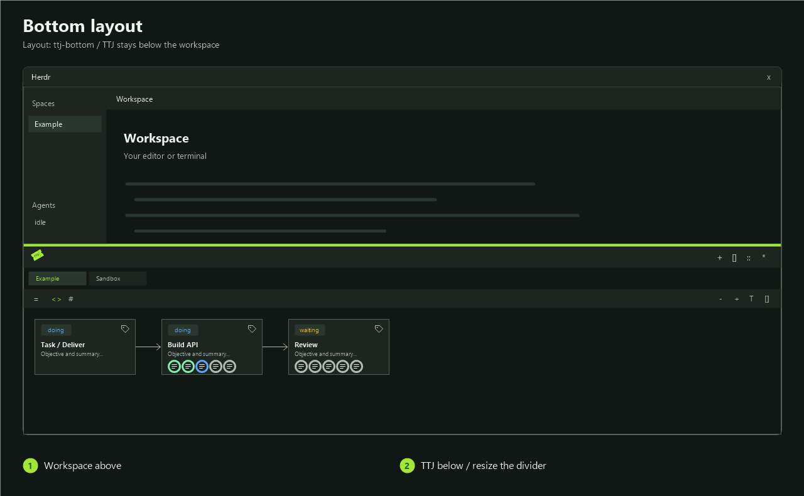
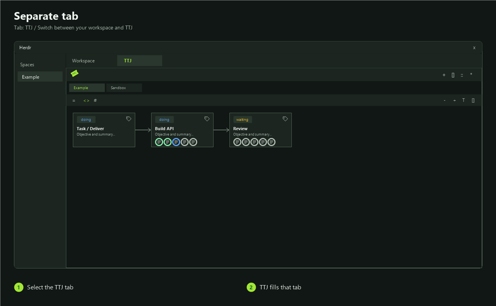
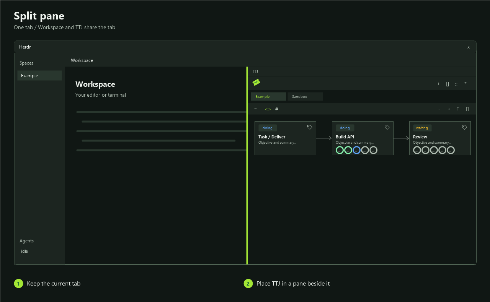
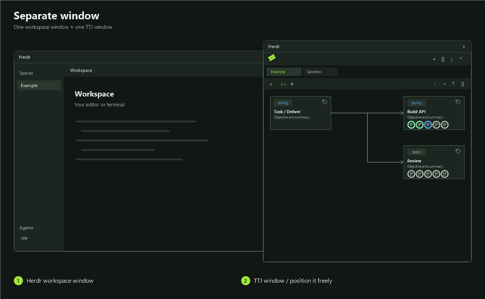

# 使い方ガイド

TTJをHerdrの横・下・別タブ・pane・別ウインドウで開く方法を説明します。図は架空のProject「Example」を使った配置図です。

## 準備

[READMEのクイックスタート](../README.md#クイックスタート)でTTJCoreとModを配置し、Herdrを起動します。Coreの起動・接続はModが自動で行います。tabやpaneで開く場合は、Herdrで対象のSpaceを選んでください。

| 開き方 | 向いている使い方 | 切替・配置 |
|---|---|---|
| [横配置](#横に開く) | 必要時だけ作業画面の横へ開く | ttj-side layoutのTTJボタン |
| [下配置](#下に開く) | 横幅を保ち、作業画面の下で確認する | ttj-bottom layout |
| [別タブ](#別タブで開く) | TTJを広く表示し、作業タブと切り替える | tab.new |
| [pane分割](#同じタブのpaneで開く) | 今のタブの中で作業画面と並べる | pane.split |
| [別ウインドウ](#別のosウインドウで開く) | 別モニターや任意の場所に置く | 別HERDR_APP_HOMEで起動 |

## 横に開く

```sh
herdr-app do layout.switch --name ttj-side
```



1. タブバーの右にあるTTJボタンを押すと、作業画面の右側にTTJが開きます。初期状態は閉じています。
2. 境界をdragしてTTJの幅を調整し、Projectタブから対象Projectを選びます。
3. 同じTTJボタンをもう一度押すか、TTJ右上の閉じるボタンで閉じます。作業タブとCoreはそのまま使えます。

コマンドから同じ開閉操作もできます。

```sh
herdr-app do layout.toggle --id ttj-panel
```

この方法はウインドウ全体のlayoutを切り替えます。戻す際は元のlayout名を指定してください。標準のlayoutへ戻す例は次のとおりです。

```sh
herdr-app do layout.switch --name main
```

## 下に開く

```sh
herdr-app do layout.switch --name ttj-bottom
```



タブバーのTTJボタンで、作業画面の下にTTJを開閉します。境界をdragして高さを調整します。横に長いcanvasやtimelineを見たい場合に使えます。閉じ方は横配置と同じです。

## 別タブで開く

タブを表示するlayoutで、新しいTTJタブを作成します。標準layoutを使う例:

```sh
herdr-app do layout.switch --name main
herdr-app do tab.new --name TTJ --mod ttj
```



TTJタブを選ぶと、そのタブ全体にTTJを表示します。作業用タブはタブバーから選び直せます。自分のlayoutにタブバーがある場合は、最初のlayout.switchは不要です。

`ttj`専用layoutはタブバーを表示しないため、別タブを使うときは`main`などタブを表示するlayoutを選んでください。

## 同じタブのpaneで開く

Herdrで分割元のpaneを選び、次を実行します。

`ttj`専用layoutを表示している場合は、先に`herdr-app do layout.switch --name main`などでpaneを表示するlayoutへ戻します。

```sh
herdr-app do pane.split --direction right --mod ttj
```



上下に分割する場合:

```sh
herdr-app do pane.split --direction down --mod ttj
```

layout全体を切り替える横配置・下配置と異なり、この方法は選択中のタブのpaneを分割します。境界をdragしてサイズを調整できます。

## 別のOSウインドウで開く



TTJ用のHerdr設定フォルダーを選び、そのフォルダーへModを配置して別ウインドウを起動します。以下はModリポジトリのルートで実行します。

PowerShell 7:

```powershell
$env:HERDR_APP_HOME = Join-Path $HOME '.config/herdr-ttj'
pwsh -File scripts/install.ps1
Start-Process herdr-app
```

ウインドウが開いたら、同じshellで次を実行します。

```powershell
herdr-app do layout.switch --name ttj
```

Linux・macOS:

```sh
export HERDR_APP_HOME="$HOME/.config/herdr-ttj"
sh scripts/install.sh
herdr-app &
```

ウインドウが開いたら、同じshellで次を実行します。

```sh
herdr-app do layout.switch --name ttj
```

`HERDR_APP_HOME`はHerdrの表示設定を分けます。HerdrのSpace・terminalを隔離する設定ではありません。同じOSユーザー・TTJCore profileを使うウインドウは同じTTJのデータに接続します。

使い終わったTTJ用ウインドウは、そのウインドウの閉じるボタンで閉じます。TTJウインドウを閉じるためにSpaceやterminalを終了する必要はありません。

## Projectを選んで使う

1. 右上の＋でProjectを作り、Projectタブから対象を選びます。
2. ツールバーからTaskを作成します。
3. Ticket作成で所属Taskを1つ選び、Jobを実行順に登録します。IDはCoreが自動発行します。

| 表示 | 用途 |
|---|---|
| timeline | Run・status変更の履歴。行をクリックするとactor・reasonなどの詳細 |
| canvas | Taskを先頭にTicketとdependsを表示。背景のdrag・wheelで移動 |
| list | Task／Ticketを切り替え、行をクリックして詳細 |

表示形式・listの種類・canvasの位置とzoomはProjectごとに保持します。canvasは＋／−、修飾キー付きwheelで拡大縮小でき、resetで初期位置へ戻せます。

カードはobjective・summary・statusを簡潔に表示します。カードや行をクリックすると、一定サイズの詳細モーダルが開きます。内容が多い場合はモーダル内をscrollします。

## 作業対象だけ表示する

キャンバス・リストのヘッダーにあるフィルターアイコンを押すと、未着手（todo）・作業中（doing）・障害（blocked）のTicketへ至る前提経路を表示します。途中にある完了・待機・中止・保留のTicketは経路として残します。完了・中止・待機で終わる末尾と、未終了の末端がすべて保留（paused）のbranchは省略します。もう一度押すと全表示に戻り、初期状態は全表示です。

選択はProjectごとに保持し、キャンバスとリストに同じ表示条件を適用します。未終了TicketがあるTaskは、全末端が保留の場合を除いて残します。全Ticketが待機中のTaskも残ります。非表示のカードにつながる線は隠します。タイムラインには全履歴を表示し、詳細ではJobと実行履歴を確認できます。

## Jobと詳細

Jobのiconにはstatus色のringが付きます。クリックするとcriteria・instructions・result・Runを確認できます。Ticket詳細のJob一覧は全件を実行順に表示します。

フッターには未着手・作業中・待機・保留・障害・完了・中止の色を表示します。キャンバスは独立したbranchを下へ分け、mergeする線は共有します。避けられない交差は半円のまたぎで表し、mergeと区別します。

カードのJobは左詰めで最大8個です。8個を超える場合はdoingのJobと最大6個の前工程、次の1個を表示します。最後のJobがdoingなら7個です。doingがない場合は最初のcompleted・canceled以外のJob、すべてcompleted・canceledなら最後を基準にします。

nametagはhoverでID、クリックでコピーします。ProjectのKnowledgeは本のアイコンから開き、Ticketのhandoffs・resumeはTicket詳細で確認します。

## 作成・編集・削除

編集・statusの変更・削除は詳細の右上です。変更にはreasonを入力します。

- Taskはobjective・criteria・deadlineを編集できます。
- Ticketはassignee・depends・handoffs・resume・priorityを編集できます。objectiveとJobの定義・順序は作成後に固定されます。
- summary・JobのiconはTTJのrecord本体とは別のdisplayです。
- 削除はcompletedまたはcanceledになった対象と配下に行う論理削除です。履歴・ID・dependsの参照はCoreに残ります。

並行する変更とconflictした場合は、最新の内容を読み直してください。

## 設定

| 設定 | 内容 |
|---|---|
| 接続 | 標準は同梱CoreまたはPATHのttjcoreを使用。customでは実行ファイル・引数・profile・自動起動を指定 |
| 操作者 | 操作のactorに使用 |
| theme | Herdrに従う／light／dark。lightは濃い緑、darkは明るい黄緑 |
| 日時の表示タイムゾーン | 既定はJST（UTC+09:00）。UTCまたは端末の設定へ変更可能 |
| icon | JobごとのkeyとSVG／PNGファイルの対応 |

Jobのiconには次の標準keyや任意のkeyを指定します。

| 作業 | key | アイコン |
|---|---|---|
| 既定 | `job` | チェックリスト |
| 調査・確認 | `search` | 検索 |
| 編集・実装 | `edit` | 鉛筆 |
| コマンド実行 | `execute` | ターミナル |
| テスト | `test` | チェックリスト |
| レビュー | `review` | 確認 |
| 文書更新 | `book` | 本 |

`github`・`custom.star`も利用できます。任意keyの設定例:

```json
{"custom.build":"mods/ttj/assets/build.svg"}
```

キー未指定・空文字・未対応のJobアイコンは標準のチェックリストで表示します。

相対pathはHerdrの設定フォルダーから参照します。theme・接続・操作者・表示タイムゾーン・iconの対応は同じHERDR_APP_HOME内で共有します。表示タイムゾーンはタイムライン・詳細の時刻・期限・Runの開始終了に適用し、保存日時と履歴の順序は変更しません。端末の設定では対象日時の夏時間も反映します。

同梱のGitHubマークはGitHub関連のJobを示します。同梱iconの利用条件は[THIRD_PARTY_NOTICES.txt](../THIRD_PARTY_NOTICES.txt)、追加するiconは提供元の利用条件に従ってください。
